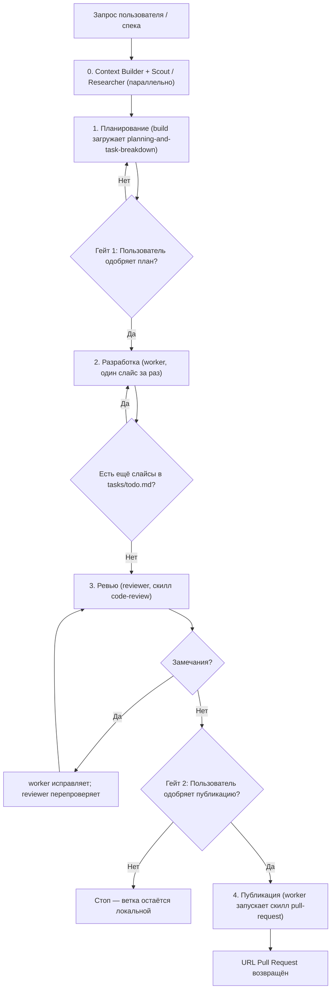

# Многоагентный цикл итераций

Полный жизненный цикл: план → реализация → ревью → публикация. Скилл
исполняет **оркестратор `build`**, который делегирует работу субагентам
и никогда не пишет код сам.



## Координатор

Скилл исполняет **`build`** (primary-оркестратор). Эти правила — жёсткие:

- `build` **никогда не пишет и не редактирует файлы кода**
  (`action: "edit", resource: "*", effect: "deny"` в `.opencode/agents/build.md`).
- `build` **никогда не запускает субагентов параллельно**, кроме паттерна
  «parallel fan-out + merge», явно разрешённого в `AGENTS.md`.
- `build` **не вызывает роли из ролей**. Только координатор обращается
  к субагентам через инструмент `subagent`.

Все действия по коду — через `worker`. Все проверки — через `reviewer`.
Все решения по согласованности — через `oracle`.

## Карта субагентов

| Фаза | Субагент | Запуск через | Какой скилл он загружает |
|---|---|---|---|
| 0. Контекст | `context-builder` / `scout` + `researcher` | `subagent` | `planning-and-task-breakdown` (для анализа) |
| 0b. Спецификация | `build` (сам) | — | `spec-driven-development` (опционально) |
| 1. План | `build` (сам) | — | `planning-and-task-breakdown` |
| 1b. Проверка | `oracle` (опционально) | `subagent` | — |
| 2. Разработка | `worker` | `subagent` | `incremental-implementation` + `tdd` |
| 3. Ревью | `reviewer` | `subagent` | `code-review` |
| 3b. Отладка | `worker` | `subagent` | `debugging-and-error-recovery` |
| 4. Публикация | `worker` | `subagent` | `pull-request` (загружает `git-conventions`) |

## Фазы

### Фаза 0 — Контекст (опционально)

Если задача требует изучения кодовой базы или внешних источников:

- **Локальный контекст:** запусти `scout` → `context.md`.
- **Внешний контекст:** запусти `researcher` → `research.md`.
- **Полный контекст с мета-промптом:** запусти `context-builder` →
  `context.md` + `meta-prompt.md`.

`scout` и `researcher` можно запускать **параллельно** одним сообщением
с двумя вызовами `subagent` — это единственный одобренный fan-out.
Результаты сливаются в один документ.

Пропускай фазу, если задача тривиальна или контекст уже собран.

### Фаза 0b — Спецификация (опционально, для крупных задач)

Если задача крупная (несколько модулей, архитектурные решения,
неясные требования) — загрузи `spec-driven-development` и проведи
пользователя через его этапы: Спецификация → План → Задачи.

Для задач с облегчённым SDD достаточно мини-спеки (три пункта:
Цель / Критерии успеха / Границы).

Если спецификация уже есть (например, загружена из issue или
создана до запуска `agent-loop`) — пропусти эту фазу и используй
существующий документ как вход для Фазы 1.

Если задача средняя или мелкая — пропусти фазу, переходи к Фазе 1
напрямую.

### Фаза 1 — План

Если Фаза 0b выполнена (спецификация утверждена) — используй её как
вход. Иначе составь план напрямую.

1. Загрузи скилл `planning-and-task-breakdown`.
2. Сгенерируй `tasks/plan.md` (архитектура, дизайн, декомпозиция) и
   `tasks/todo.md` (чек-лист задач `[ ]`).
3. **Опционально:** если план затрагивает унаследованные архитектурные
   решения — запусти `oracle` для проверки на drift.

### Гейт 1 — Одобрение плана

Предъяви `tasks/plan.md` и `tasks/todo.md` пользователю. **Не начинай
реализацию без явного одобрения.** Если пользователь возвращает правки —
вернись в Фазу 1.

### Фаза 2 — Разработка

Пока в `tasks/todo.md` есть незавершённые задачи:

1. Возьми **первую незавершённую** задачу. Не начинай вторую.
2. Запусти `worker` через `subagent` с задачей, ссылками на `context.md`
   и `plan.md`, и критериями готовности.
3. `worker` загружает `incremental-implementation` (вертикальный слайс)
   и `tdd` (red → green).
4. `worker` реализует, проверяет локально, **делает один атомарный
   коммит** (см. `git-conventions`), отмечает задачу `[x]` в
   `tasks/todo.md` и отчитывается в формате:
   ```
   Implemented X.
   Changed files: Y.
   Validation: Z.
   Open risks/questions: R.
   Recommended next step: N.
   ```
5. Если `worker` вернул непустой `Open risks/questions` — координатор
   либо решает сам, либо задаёт вопрос пользователю через `question`,
   после чего перезапускает `worker`. 
   Пустое значение (`Open risks/questions: —` или отсутствие строки)
   означает, что блокировки нет.

### Фаза 3 — Ревью

1. Определи фиксированную точку (базовый коммит ветки или последний
   merge-base).
2. Запусти **двух** `reviewer` **параллельно** (одним сообщением,
   двумя вызовами `subagent`) — это одобренный fan-out:
   - Reviewer A — ось **Standards**: соответствие документированным
     стандартам, пяти измерениям качества и smell-baseline.
   - Reviewer B — ось **Spec**: соответствие исходной спеке / issue /
     PRD.
   Передай каждому фиксированную точку, путь/URL спеки (для B) и
   список стандартов (для A).
3. Собери оба отчёта. Не сливай findings между осями — они
   представляются рядом (как описано в `code-review`).
4. Если есть findings — передай `worker` только обязательные
   (severity не `Nit` / `FYI`). `worker` исправляет и коммитит.
   Затем перезапусти двух ревьюеров на новом диффе.
5. Повторяй до нуля findings. Затем — Гейт 2.

**Режим `strict`:** если задача высокорисковая (миграции БД, auth,
изменение контрактов) — вставляй раунд `reviewer` после **каждого**
слайса, а не в конце.

### Гейт 2 — Одобрение публикации

Кратко доложи: число слайсов, коммитов, findings после ревью, URL
фича-ветки. Спроси подтверждение публикации.

### Фаза 4 — Публикация

1. Запусти `worker` через `subagent` с задачей «опубликовать ветку».
2. `worker` загружает скилл `pull-request` (тот загружает
   `git-conventions`).
3. `worker` выполняет `git push` и `gh pr create` с шаблоном PR.
4. `worker` возвращает прямую ссылку на PR.

`build` **не выполняет публикацию сам** — у него нет прав `edit` и
`shell` для `git push` / `gh pr create`. Публикация — работа субагента.

### Завершение

Верни пользователю:

- URL Pull Request;
- сводку: число слайсов, коммитов, findings до/после;
- открытые риски из последнего отчёта `worker` и `reviewer`.

## Состояние

| Файл | Кто пишет | Назначение |
|---|---|---|
| `tasks/plan.md` | `build` (после Фазы 1) | Архитектура, дизайн, декомпозиция |
| `tasks/todo.md` | `build` (создаёт) + `worker` (обновляет `[x]`) | Единый чек-лист прогресса |
| `context.md` | `context-builder` / `scout` | Контекст для передачи субагентам |
| `research.md` | `researcher` | Внешние находки |
| `progress.md` | `worker` / `reviewer` | Локальный журнал (не коммитить, добавить в `.gitignore`) |

`tasks/todo.md` — единственный источник истины о прогрессе. Если он
потерялся — цикл возобновляется с текущего состояния git.

## Эскалация

Субагенты не могут общаться с родителем во время выполнения. Если
субагент заблокирован, он возвращает блокирующий вопрос в финальном
ответе.

- **Пробел в утверждённом плане:** `worker` возвращает
  `Open risks/questions: <...>`; `build` либо решает сам, либо задаёт
  вопрос пользователю через `question`, после чего перезапускает
  `worker`.
- **Drift от унаследованных решений:** `build` запускает `oracle`;
  рекомендация фиксируется в `tasks/plan.md`.
- **Провал теста или сборки:** `worker` загружает
  `debugging-and-error-recovery`, не обходит ошибку.
- **CI-провал после push:** `worker` получает лог CI и исправляет; при
  повторном провале — Гейт 2 снова.

## Критерии выхода

- [ ] `tasks/todo.md`: все пункты `[x]`.
- [ ] `reviewer` отчитался нулём findings по обеим осям (`Standards` + `Spec`).
- [ ] Все тесты и сборка проходят локально.
- [ ] Все коммиты соответствуют `git-conventions` (Conventional Commits, атомарные).
- [ ] `worker` запушил ветку и открыл PR; ссылка передана пользователю.
- [ ] Ни одного файла, оставленного в состоянии «незакоммичено».
- [ ] Никаких заглушек, `TODO`, закомментированного кода в диффе (см. `incremental-implementation`).

## Антипаттерны

- Координатор (`build`) сам правит код. Нарушает `AGENTS.md`.
- Ревью после **каждого** слайса без явной необходимости — тратит
  контекст и время. По умолчанию — feature-level.
- Пропуск Гейта 1 и старт реализации без утверждения плана.
- Публикация без Гейта 2.
- Смешивание нескольких слайсов в одном коммите.
- Вызов `oracle` «на всякий случай» — только при реальном конфликте с
  унаследованными решениями.
- Вызов `researcher` без внешней зависимости — это лишний круг сети.

## Связь с другими скиллами

- `planning-and-task-breakdown` — Фаза 1.
- `incremental-implementation` и `tdd` — Фаза 2 (загружает `worker`).
- `code-review` — Фаза 3 (загружает `reviewer`).
- `debugging-and-error-recovery` — Фаза 3b при провале.
- `pull-request` + `git-conventions` — Фаза 4 (загружает `worker`).
- `ci-cd-and-automation` — не входит в цикл; вызывается отдельно при
  настройке конвейера.

## Как вызвать

```
Задача: <одно предложение>

Запусти agent-loop для этой задачи.
```

Или через явную команду верхнего уровня, если она зарегистрирована:

```
/agent-loop "<описание задачи>"
```